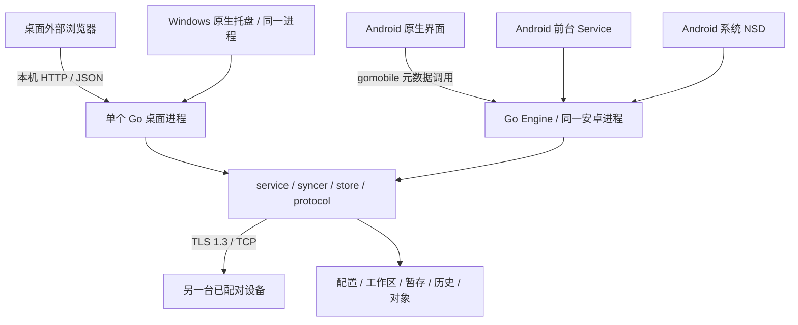
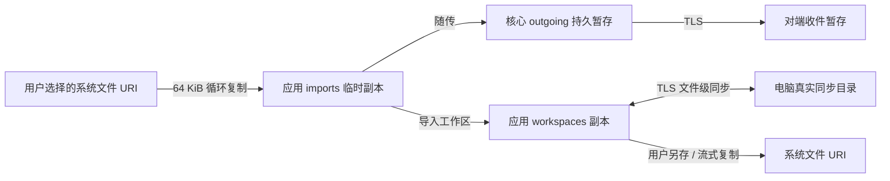

# PolySync 跨平台技术设计与实现核对报告

版本：评审稿 1.2（含 2026-09-24 修复增补） · 日期：2026-09-22 · 范围：当前工作区代码、既有验证记录、当日只读内存快照。

> **后续实现更新（2026-09-24）**：正文审计基线仍为 9 月 22 日；R04/R05/R07/R08/R09/R17/R18/R19 已有基础修复或部分缓解，当前状态与限制见 [基础风险修复记录](E:/wjdfo/Documents/ChatGPT/Polysync/docs/basic-risk-fixes-2026-09-24.md)。原风险描述保留作审计依据，不应当作上述改动后的全部现状。

**本文首先描述实际实现，其次列出与产品目标的差距，最后提供待确认方案。建议、构建成功和真机验证分别标注，不相互替代。**

建议阅读顺序：先看第 1 节的实际差异与第 15 节的决策表；后台重点看第 5、10 节，内存看第 9 节，UI 动线看第 11 节，源码和验证依据在第 16 节。

## 1. 先说明最重要的结论

产品目标是：面向个人设备的同步与随传，服务能够低负担长期运行；任务期间尽量降低占用，但不能以明显损害可用性和体验为代价。

当前实现尚未完整达到这一目标。以下内容应先核对：

| 编号 | 当前实际行为 | 对用户的影响 | 核对结论 |
| --- | --- | --- | --- |
| C01 | Android 后台空闲约十分钟后主动停止接收服务 | 此后不能持续被发现、接收文件或响应电脑发起的同步 | 这是代码中加入的产品策略，不是 Android 强制的“十分钟规定”；此前没有与你充分核对，与常驻目标冲突 |
| C02 | Android 核心设置 `DisableAutoSync: true`，新工作区 `autoSync: false` | 手机不会主动定期检查工作区变化，也没有文件事件监听；需手动同步或由另一端发起 | 自动发现已经实现，但不等于自动同步已经实现 |
| C03 | Android 同步的是应用私有工作区中的副本 | 导入原文件后，原文件的后续修改不会自动进入工作区；导出也是一次复制 | 尚不是“选择手机任意系统文件夹，持续双向同步” |
| C04 | Windows 可在关闭网页后继续运行；Linux/macOS 仍依赖启动进程存活 | Windows 有托盘；Linux/macOS 没有随包提供守护服务、登录启动或原生托盘 | 同一 Go 核心不代表相同的桌面产品完整度 |
| C05 | 停止 Android Service 不等于结束应用进程或立即释放内存 | 当前实机在无接收服务、进程被冻结时仍有约 88.4 MiB PSS | 不能把自动停服务称为已经完成的内存优化 |
| C06 | 数据内容通常流式传输，但目录清单、任务历史、部分冲突操作仍有较大内存风险 | 文件数、历史数、并发和冲突文件大小都可能影响峰值 | “流式传输”不构成“整个应用恒定内存”的保证 |
| C07 | Windows MSI/应用内更新已有实现；完整自动重启验证曾受本机应用控制策略阻碍 | 不能把该机器上的完整升级链路写成全部通过 | 安装能力、代码验证、真实升级成功必须分开表述 |
| C08 | iOS 尚无客户端实现；macOS/Linux 尚缺完整桌面真机验收 | 没有 iOS 内存数据、UI 或后台实测；交叉编译也不是平台验收 | 不应宣称各平台功能或资源表现一致 |

十分钟策略虽出现在安卓通知和“接收服务”管理弹窗中，但这不等于已经获得产品层面的确认。此前交付时应主动把它作为重要取舍说明。本报告不追认这一选择，也不在你审阅报告前顺带修改运行策略。

## 2. 报告口径与可追溯范围

### 2.1 状态标记

- **已实现**：在当前代码中找到对应路径，不代表所有平台已运行验证。
- **已验证**：有明确日期、设备或测试记录；本轮没有重新运行全部历史测试。
- **代码推断 / 待验证**：实现能够支持这一判断，但没有覆盖该场景的实际测量或复现。
- **建议 / 待决策**：尚未实现，不作为产品现有能力。

### 2.2 版本边界

审计基于当前工作区。Git HEAD 为 `9a5f94e2e5bb6617ce6a970542d2b294af06c446`（v0.3.0 发布提交），其上还有未提交的安装更新、移动端等改动。因此，**HEAD、当前代码、已有发布包、手机安装包不是同一个版本状态**。

安卓已安装包为 `0.5.0-dev.2`，arm64 调试包，11,733,536 字节，SHA-256 为 `1478f0cd7c82378aaef2cd4c7fd23bcf88828075781f8772a6e0cf6bba6913f7`，此前已与手机安装的 `base.apk` 核对一致。桌面构建脚本默认版本仍为 `0.4.0`。本报告不新增发布，也不据此断言远端最新发布版本。

1.0 编制包含代码审计、官方平台约束核对、只读内存取样和文档整理；1.1 根据独立复核意见再次核对源码并修订报告，采纳及修正说明见 §16.4。两个文档阶段均未更改运行代码、用户同步目录、手机安全设置或后台策略。

## 3. 平台能力矩阵

| 项目 | Windows | Linux | macOS | Android | iOS / iPadOS |
| --- | --- | --- | --- | --- | --- |
| 核心 | Go | 同一 Go 核心 | 同一 Go 核心 | Go 经 gomobile 嵌入 | 尚未实现 |
| 已提供构建目标 | amd64 | amd64、arm64 | amd64、arm64 | arm64-v8a | 无 |
| UI | 外部浏览器，本机网页 | 外部浏览器，本机网页 | 外部浏览器，本机网页 | Kotlin 原生 Activity/View | 无 |
| 应用自带 WebView | 无 | 无 | 无 | 无 | 不适用 |
| 常驻形态 | 当前用户普通进程＋原生托盘 | 普通终端进程 | 普通终端进程 | 同进程前台 Service，当前会空闲停止 | 无 |
| 登录/开机自动启动 | 未集成 | 未集成 systemd 用户服务 | 未集成 LaunchAgent | 无启动广播/调度恢复 | 无 |
| mDNS | Go zeroconf | Go zeroconf | Go zeroconf，非原生 Bonjour 外壳 | Android NsdManager 注册＋发现 | 未实现 |
| 自动检查同步 | 按文件夹周期 | 同左 | 同左 | 关闭 | 未实现 |
| 文件事件同步 | 未实现 | 未实现 | 未实现 | 未实现 | 未实现 |
| 文件夹语义 | 用户选择的真实目录 | 同左 | 同左 | 应用内工作区副本 | 待设计 |
| 随传发送 | 多文件批次 | 同左 | 同左 | UI 单文件选择；核心可接收多文件批次 | 未实现 |
| 冲突处理 UI | 查看并处理 | 同一网页能力 | 同一网页能力 | 仅提示去电脑处理 | 未实现 |
| 安装 | 按用户 MSI；保留 EXE | 可执行文件 | 可执行文件，无完整 .app/DMG 产品包装 | USB 侧载 APK | 无 |
| 应用内安装更新 | 仅 Windows amd64 | 未实现 | 未实现 | 未实现 | 未实现 |
| 主要实测状态 | 功能及部分 MSI 实测；自动重启存在环境阻碍 | WSL Go 测试/构建，不等于 Linux 桌面验收 | 交叉构建，不等于 macOS 真机验收 | vivo V2417A / Android 16 功能实测 | 无 Mac/iPhone，未验证 |

Android `minSdk=29`、`targetSdk=36`、`compileSdk=36`，声明的最低系统是 Android 10，但目前只在 Android 16 真机验证。Windows arm64、安卓 x86 模拟器等不属于当前已有产物覆盖。

## 4. 总体架构与进程边界



图中的“Core”表示共享代码，不是跨进程共享的同一个运行实例。

### 4.1 桌面

`cmd/polysync` 先绑定本机控制台端口，再初始化配置、更新管理器、TCP 服务、发现和调度。默认同步端口为 TCP `45123`，控制台为 `127.0.0.1:45124`，发现使用 mDNS。网页通过 `go:embed` 随程序分发，UI 使用原生 HTML/CSS/JavaScript 和系统字体。

托盘、同步、随传、发现和 HTTP 控制台都在一个 Go 进程内。浏览器是另一个已有系统应用，其全部进程占用不能计成 Go 后台进程占用；但评价“打开界面时总成本”又不能完全忽略浏览器。

更新 helper 只在安装阶段短时出现。文件选择/另存还可能启动短时平台进程：Windows 使用 PowerShell/系统对话框，macOS 使用 osascript，Linux 使用 zenity/kdialog 等；这些成本应归入交互场景，不能算作一直常驻，也不能在测整次操作时漏掉。当前没有独立常驻更新服务、中心协调服务器、云文件中继、账号体系或蓝牙通道。

### 4.2 Android

一个应用进程包含 ART/Kotlin UI、原生图形资源、Go 运行时、TLS/TCP 核心与前台 Service。Service 没有声明独立 `android:process`，因此当前无法把“UI 进程内存”和“服务进程内存”作为两个真实进程分别测量。

`mobile.Engine` 不启动 HTTP 监听器，但仍启动真实的 TLS/TCP 同步监听，当前安卓固定传入所有网卡地址 `:45123`；“无 HTTP 服务”不等于“无网络监听”。它不启动桌面托盘或更新管理器。它在进程内复用现有 HTTP handler，以 JSON 请求/响应连接原生界面与 Go 核心；这避免新增控制台端口，但仍存在 JSON 编码、跨绑定字符串、Kotlin 解析的分配成本。文件正文使用文件流，不通过 Java/Go 绑定传递整文件字节数组。

## 5. 后台生命周期：实际行为与取舍

### 5.1 桌面生命周期

| 动作/场景 | 当前结果 |
| --- | --- |
| 打开程序 | 默认启动服务并打开浏览器；Windows 同时显示托盘 |
| 关闭网页 | 只结束该页面的 UI 轮询，不停止 Go 服务 |
| 空闲无任务 | 程序继续运行，没有十分钟停止规则 |
| Windows 托盘退出 | 取消服务上下文，关闭监听器/连接，移除托盘图标；活动随传会提示确认 |
| 仅有同步任务时退出 | 没有与随传同等的专门退出确认，退出会中断本轮同步 |
| Ctrl+C / SIGTERM | 走关闭流程；HTTP 优雅关闭最多等待八秒，核心停止等待工作退出 |
| 电脑休眠/注销/关机 | 不能保证继续接收；没有额外唤醒或登录外服务机制 |
| 程序崩溃/被终止 | 无内置常驻守护程序保证自动拉起 |
| 再次启动 | 重新加载配对和同步配置；已有活动随传记录标为中断，不自动断点续传 |

Windows 当前是“登录用户下的托盘程序”，不是 Windows Service。Linux/macOS 的 `tray_other.go` 只等待退出上下文，并不提供系统托盘。用户自行配置守护运行是另一种部署方式，不能算当前安装体验已经实现。

### 5.2 Android 十分钟停止的准确含义

代码位于 `SyncService.kt` 的 `watchdog`：约每十秒检查一次核心任务状态。页面可见，或存在 `preparing/connecting/sending/receiving/verifying` 随传任务，或同步状态为 `syncing` 时，更新 `lastActive`。当页面不可见且距离最后一次上述活动超过十分钟，调用 `stopSelf()`。

这意味着：

1. 不是“每次传输十分钟后强制截断”；被识别为活动的传输会刷新计时。
2. 不是“锁屏恰好十分钟退出”；检测粒度、工作队列、系统调度都会影响时刻，且使用墙钟计时。
3. 没有接收新文件的等待状态本身不会持续刷新计时。因此，用户最需要的“安静等待下一次随传”会被判为可停止。
4. 停止会注销 NSD、停止 Go 引擎、关闭同步监听器并移除前台通知。以后局域网请求不能凭空把已停止的监听器唤醒。
5. `START_NOT_STICKY` 表示当前实现不要求系统在服务被杀后自动重建它；没有开机恢复、WorkManager 或其他恢复路径。
6. `onTimeout()` 也会停止服务，这是另一个来自系统的停止入口，与应用自己的十分钟策略不同。
7. Service 停止不等于应用进程结束；静态执行器和运行时仍可能留在缓存进程中，系统最终如何回收由其管理。

当前唯一服务控制是启动、停止、重新发现，没有常驻模式/省电模式选择，也没有明确的后台接收期限设置。

### 5.3 Android 系统约束不能混同为十分钟规则

当前 Service 类型是 `dataSync`。Android 官方规定，在适用的 Android 15+ 环境且应用 target 35+ 时，该类型在后台有累计运行时限，通常为每二十四小时六小时；用户回到前台会重置相关计时。**这不是十分钟空闲限制，也不能通过简单删除十分钟判断就承诺全天在线。** [Android 前台服务超时](https://developer.android.com/develop/background-work/services/fgs/timeout)

设备间持续通信可评估 `connectedDevice` 或伴生设备相关 API，但必须确认真实用途、权限和生命周期匹配；这只是后续设计候选，不是当前已经采用或已证明能覆盖所有厂商的方案。[Android 前台服务类型](https://developer.android.com/develop/background-work/services/fgs/service-types)

推荐产品方向是保留“用户明确选择的后台接收意图”，在系统允许范围内持续服务；如果系统停止，应该能看到停止原因、恢复入口与不可接收状态。不能用未解释的自动退出替代低内存设计，也不能承诺系统不允许的永久存活。

### 5.4 当前生命周期还需验证的细节

- **代码推断**：Activity `onCreate()` 会调用 `startSync()`。用户停止服务后，旋转等 Activity 重建可能再次启动服务；“用户已选择停止”的意图没有持久化。
- **代码推断**：大文件进入核心任务前的系统 URI 导入，以及文件导出，不属于 watchdog 统计的活动任务。Activity 处于 resumed、`visible=true` 时不会因这项空闲判断停止；风险窗口是导入/导出仍在进行但用户切到后台或锁屏，需要专门测试。
- **代码推断**：导入、UI 查询与 watchdog 共用三线程池；若线程被慢文件提供器占用，状态反馈和检查可能延迟。
- 服务启动失败会保存错误并调用 `stopSelf()`，未见自动重试或退避；错误可在服务管理弹窗查看，不能据此认定有自动恢复能力。
- 最近任务划掉、系统强行停止、后台限制、锁屏、Doze、网络切换和长时间服务运行尚未形成完整验收矩阵。

## 6. 发现、连接与信任模型

### 6.1 自动发现

桌面用 Go zeroconf 注册和浏览 `_polysync._tcp`，Android 用系统 NsdManager 注册和浏览 `_polysync._tcp.`，协议版本为 2。广播包括设备 ID、名称、公钥、指纹和服务端口；这些是局域网发现信息，不是加密的私密名称目录。

Android 的“发现事件驱动”仅指 NSD 设备发现，不代表文件变化已经事件驱动。Android 接到发现/丢失事件后，经单线程工作队列发布快照到 Go；没有另一套 Go mDNS 套接字重复扫描。

| 细节 | 桌面 | Android |
| --- | --- | --- |
| 在线判定 | 发现记录最近九十秒视为在线；已配对设备最近通信也影响状态 | 原生发现项保持到系统报告丢失；已配对设备另受核心最近通信状态影响 |
| 缓存边界 | 附近设备 map 未见总量上限及过期删除，只改变在线标记 | 原生最多跟踪 128 个发现服务；Go 快照最多 128 台，每台最多 16 个地址、快照 128 KiB |
| 解析 | 库负责浏览；应用未规定固定每秒查询频率 | 兼容旧系统，一次解析一个服务，按队列处理 |
| 失败处理 | 日志与手动地址后备 | 状态文字、手动添加、“重新发现” |
| 网络变化恢复 | 未完成统一验收 | 未建立完整自动重试/网络切换恢复验收 |

**发现快照还有失败原子性问题**：`ReplaceExternal` 先验证整份快照，任一条不合法便整份拒绝，保留最后一次成功结果；安卓 `publish()` 的 catch 把所有异常都当作服务停止而静默忽略。若异常条目持续存在，后续快照也持续失败，新设备/离线变化可能无法反映；只有后续有效快照成功应用才恢复更新。不能把它说成永久冻结，也不能因为 NSD 自身正常就认定列表一定已更新。原生 128 个服务名额按发现顺序占用，当前没有为已配对设备保留名额。

“在线”是发现/最近通信线索，不是实时的端口探测承诺。设备刚退出、网络隔离或地址变更时，仍可能短时间显示在线但连接失败。工作区同步使用已保存的对端地址；不能假定每次都会从最新 NSD 地址集合自动择优重连。

### 6.2 配对与连接

流程为：发现或手动地址 → 对方批准 → 发起方输入六位码 → 双方验证签名与身份 → 保存长期公钥。请求创建后约六十秒过期；接收方确认处理最多允许三次尝试。mDNS 只是地址提示，不授予访问权限。

通信使用 TCP、TLS 1.3、Ed25519 长期身份和配对公钥固定。这里采用自签身份与应用层信任，不是普通公网 CA 域名证书模型。已配对访问要核对证书公钥；手动发现/首次接触后仍必须完成配对确认。

出站连接超时八秒，TCP KeepAlive 配置三十秒；这不是每三十秒对全部设备做应用心跳。同步和随传在连接处理开始时一次性 `SetDeadline(now + 2h)`；这是绝对截止时间，不会随持续传输续期，也不是两小时无活动才超时。长任务可能在后续网络读写中因截止时间到达而失败；等待对端数据的连接可能一直占用到期限，除非提前完成、关闭、取消或出错。它不覆盖入站 TLS 握手前阶段，也不直接取消所有耗时本地计算，更不是断点续传。

### 6.3 安全边界与权限

- 桌面控制台默认只绑定回环地址；普通 API 有 Origin 检查及 CSP 等响应头，但不是一套面向不可信网络的完整登录认证服务。**不得把 `-ui` 改为全网监听后仍称其与默认配置同等安全。**
- 同步端口与控制台的暴露范围不同：桌面默认 `-listen :45123`，安卓当前固定 `:45123`，均监听所有可绑定网卡；可达范围还受系统防火墙、路由和网络策略影响。桌面可用 `-listen` 收窄；安卓尚无对应 UI/启动配置。TLS 加密、配对鉴权与握手前资源防护是不同层次，不能说暴露面已“完全由 TLS 承担”。
- 更新写操作额外要求回环连接、正确 Host 和每次进程随机令牌。
- 普通文件同步拒绝危险相对路径和符号链接路径；安卓工作区进出限制在应用目录及用户选择的系统 URI。
- 私钥、配对配置、文件暂存与历史放本地。当前未集成 Windows DPAPI、Android Keystore 或跨平台静态数据加密；文件权限/沙箱不等于应用层加密。
- Android 请求网络、前台服务、dataSync 和通知权限；没有声明全盘文件管理、位置、蓝牙、相机或开机启动权限。调试构建只为测试允许访问 `127.0.0.1` 明文控制接口，文件互通仍走 TLS。
- target SDK 提升到 37+ 时，需要按新局域网权限或系统选择器模型适配；当前 target 36 的验证不能代替该迁移验证。[Android 局域网权限](https://developer.android.com/privacy-and-security/local-network-permission)

**分操作鉴权边界**：`identify` 在配对前公开设备 ID、名称和公钥；`pair_request` 接受未配对设备提交申请，但要求请求公钥与其 TLS 证书一致，后续仍需本机批准和验证码。未见申请来源限速或总量上限，因此有骚扰提示和资源占用风险。不能仅看外层 switch 就推断 `share_invite` 可绕过配对：`handleShareInvite`、`handleShareAccept` 和 `handleTransfer` 内部都会调用 `requirePaired`。

**地址学习边界**：已通过设备公钥和同步空间绑定校验的对端，可以用 `hello.ListenPort` 更新保存的对端地址；IP 来自实际连接 `RemoteAddr`，端口已限制在 1–65535。当前没有验证新端口是否确实可用于后续同步。错误端口可能破坏后续连接的可用性，但不等于任意第三方 IP 重定向或绕过公钥固定。

**待加固项**：TCP 接入没有明确的全局连接配额；入站 TLS 握手之前未见单独握手期限；较大控制帧及发现/会话集合的边界尚不统一。这是代码审计发现的资源防护缺口，不代表已经复现攻击或完成安全审计。

## 7. 同步算法与跨平台文件语义

### 7.1 当前同步过程

1. 取得同步空间锁；同一空间不会同时启动两轮同步。
2. 建立并验证对端连接。
3. 完整遍历普通文件，并逐个计算 SHA-256；读取共同基线。
4. 比较本地、远端与共同基线，生成传输、删除及冲突计划。
5. 传输完整的变化文件；接收侧写临时文件并校验摘要，覆盖/删除前归档旧内容。
6. 再扫描并核对最终清单；一致时保存共同基线，否则后续重新校对。

这是**文件级同步**，不是块级差分同步。大文件修改一小段后，当前仍可能重传整个文件。重命名没有专用协议语义，通常表现为旧路径删除、新路径增加。对象库按内容哈希去重，主要服务于历史/冲突内容，不等同于网络块去重。同步两端前后扫描后均调用 `cacheObjects`，逐文件检查对象是否存在；`PutObject` 对已有哈希立即返回，仅缺失对象才复制正文并计算校验。`history` 则在覆盖/删除等归档路径写入，不是每遍扫描都归档。因此无变化扫描仍有检查/读盘成本，但不能说“每遍扫描都重复写所有对象和历史”。

每个同步空间绑定一个对端。当前不是可以任意叠加多个同根目录的多设备 mesh：目录重叠检查会限制此类配置。面向三台及以上设备的同一资料集，需要另行设计拓扑、基线和冲突传播，不能用“支持多个文件夹”替代这一能力。

### 7.2 自动同步和首次同步

桌面调度器每两秒检查任务是否到期，不是每两秒扫描所有文件。每个文件夹可设置 5–86400 秒间隔；输入小于五秒会归一化到三十秒，超上限截断；到期判断叠加 0–2999 毫秒设备抖动。没有指数退避式离线重试策略，主要仍依照周期尝试。

启动时，已启用自动同步的活动空间在首个调度周期进入检查，因此已经有一定“启动后自动检查”的行为；这不是所有空间无条件启动扫描。接受同步邀请会触发首次同步，和后续自动循环是两件事。

Android 没有定时自动循环；接受邀请后的首次同步、点击“立即同步”、其他设备发起的同步仍然可以发生。**手机导入副本后只提示用户点击同步，并未自动触发一轮同步。**

### 7.3 冲突、删除与数据保护

| 情况 | 当前语义 |
| --- | --- |
| 单端新增/修改 | 复制到另一端 |
| 单端删除，另一端未变 | 删除传播，旧内容归档 |
| 双端内容相同 | 不重复传文件 |
| 双端同一路径不同修改/新增 | 保留双方内容，产生冲突 |
| 一端删除、另一端修改 | 交给用户解决，不静默选择 |
| 同步期间文件继续变化 | 最终清单不一致时不提交错误共同基线 |
| 同步根不存在/扫描出错 | 报错，不把“无法访问目录”直接视为正常空目录 |

仅支持普通文件；空文件夹本身不作为独立同步对象。符号链接、socket、设备文件等不作为正常文件复制。跨系统大小写、保留文件名、权限位和扩展属性存在差异；代码没有承诺完整复制 ACL、xattr、资源叉或所有平台文件系统元数据。

桌面可查看 base/local/remote 文本并编辑合并结果；文本对象和合并输入的上限是 5 MiB，但“选择本地/远端版本”目前直接整文件读取，**不受这个文本预览上限保护**。预览不可用时网页仅提示“二进制文件或文件过大”，未展示 5 MiB 数值；合并提交校验失败又使用“不是受支持的文本文件”等文案，边界说明不够一致。Android 只提示去电脑处理，没有冲突处理页面。

## 8. 随传与手机文件存储

### 8.1 桌面随传动线与数据路径

选择/拖入文件 → 选择在线已配对设备 → 上传到本机 Go 暂存区 → 界面显示已交给后台 → TLS 发送 → 对端自动暂存 → 用户另存到目标位置。

关闭网页能否继续，边界在“本机上传是否完成”。上传尚未完成时，页面有离开提示；已交给后台后网页不再承担正文传输。无云中继，不支持离线排队。

核心每批 1–128 个普通文件，合计最多 16 GiB，最多四个活动随传任务。四个名额由一个核心服务实例的 `transferManager` 统一计数，发送、接收及所有对端共享；当前正常桌面/安卓部署各使用一个这样的实例，因此表现为该应用进程共享四个名额。它不是每个对端四个，也不是发送与接收各四个。单一已配对对端在其他条件允许时可占满接收名额。这个“四个”限制不涵盖所有同步空间、TLS 连接、UI 查询和文件导入，不能当作整个应用的全局并发上限。

### 8.2 Android 导入、发送与导出



导入结束后 `imports` 临时文件通常由 `finally` 删除；随传 outgoing、收件与工作区不是同一种临时数据，不会因为传输结束自动清空。随传发送准备过程中可能同时存在原始文件、导入副本和核心暂存副本；**这是磁盘复制成本，不等于三份文件都加载进 RAM**。

Android 默认 `AutoReceive=true`；移动 API 白名单不包含 `/api/transfer-settings`，因此手机当前既没有独立接收开关/目录选择 UI，也不能经现有移动桥调用这些设置。在服务运行、配对鉴权及任务/空间校验通过时自动接收；用户仍可停止整个服务，不能说“完全无法关闭任何接收”。

Android 发送 UI 一次选择一个文件；系统 `ACTION_OPEN_DOCUMENT` / `ACTION_CREATE_DOCUMENT` 授予对应 URI 的访问，不需要全盘权限。没有持久树 URI 授权、系统任意目录的持续同步、分享菜单 `ACTION_SEND` 接收入口或文件管理器“分享到 PolySync”流程。

工作区导入对同名文件用独占创建，当前会报错而不是覆盖；导入不跟踪源 URI 的后续修改。工作区列表最多枚举 2000 个文件，超出时整体报“文件较多，请在电脑上查看”，并非分页。这个数量只限制手机查看列表，不限制同步核心清单。

### 8.3 数据保留与磁盘增长

| 数据 | 保存位置/用途 | 当前回收策略 |
| --- | --- | --- |
| 桌面配置和身份 | Windows `%APPDATA%/Polysync`；Linux 用户配置目录；macOS Application Support | MSI 升级/卸载保留，不自动清理 |
| Android 数据 | 应用 `filesDir/polysync` 下 state、imports、workspaces | 普通卸载/清除应用数据会失去应用内资料；UI 要求提前导出，系统备份被关闭 |
| 随传发送缓存/收件 | outgoing / inbox 或用户选定暂存位置 | 当前不自动清理；桌面移除记录可选择是否删文件 |
| 手机任务历史/缓存 | 与核心相同的数据模型 | 手机没有删除历史/清缓存入口；移动桥也不开放独立接收开关/目录设置，停止整个服务才会停止接收 |
| 同步历史 | history 下覆盖/删除前的副本 | 无保留期限、容量配额或自动回收 |
| 内容对象库 | objects，按 SHA-256 存储 | 无对象垃圾回收；内容不同的版本继续累积 |
| 冲突、基线、任务记录 | 磁盘 JSON | 无统一数量/容量配额 |
| 更新下载与 helper | 用户缓存目录的 updates | 成功产物和排错文件保留，未实现自动清理 |

自动清理不能直接粗暴删除仍用于重试、共同基线或冲突处理的数据。后续必须先明确保留承诺，再实现引用检查和有边界的回收。

## 9. 内存管理：已有机制、真实数据与缺口

### 9.1 应该分别评价的指标

“轻量”至少分四个场景：界面关闭但仍可接收的空闲服务、界面打开、传输/扫描期间、任务完成后的回落。停止服务后再测得较低值，不是常驻服务达标。

Windows 工作集表示驻留物理页，私有提交反映私有已提交内存，二者不能相加。Android PSS 按比例分摊共享页，RSS 包含完整驻留共享页；Android PSS、Windows 私有提交、APK 大小不是同一种指标。ART Java Heap、Native Heap、图形和映射代码要分开看，Native Heap 也不能直接等同于 Go 活跃堆。[Android 内存概述](https://developer.android.com/topic/performance/memory-overview)

### 9.2 当前代码中的资源边界

| 部分 | 已有机制 | 未解决的问题/影响 |
| --- | --- | --- |
| 文件正文 | `io.Copy/CopyN`，安卓导入导出 64 KiB 缓冲 | 正文通常不按整文件大小驻留；仍有磁盘复制和并发成本 |
| 文件扫描 | 单文件 SHA-256 缓冲 256 KiB | 每次扫描读取全部文件；缓冲反复分配，未建立摘要缓存/事件索引 |
| 协议连接 | 每个 Framer 读写各 256 KiB，合计约 512 KiB 基础缓冲 | 不包含 TLS、goroutine 栈、JSON、清单；连接数未全局设限 |
| 控制帧 | 单个 JSON 控制帧最大 128 MiB | 收帧整块分配再 JSON 解析，解析后的对象还会叠加；写帧先 Marshal 再检查大小；正文 `CopyFrom/CopyTo` 不受这个帧上限约束，正常文件/随传入口另有 16 GiB 限制 |
| 目录清单与同步计划 | 本地/远端/基线列表、索引 map、最终清单 | 内存随文件数量增加；不同空间可并发，没有全局扫描预算 |
| 随传活动任务 | 最多四个 | 不等于四个线程或全系统并发上限 |
| 随传历史 | 启动全部载入 map | 无分页或常驻条数上限；查询克隆、排序并逐个核对文件可访问性 |
| 冲突查询 | 需要时遍历冲突 JSON 文件 | `/api/status` 会调用且丢弃读取错误；遇损坏记录可能仅返回此前已读取的部分列表，首条即失败时可能为空，不可当成可靠的“没有冲突” |
| 冲突解决 | 文本预览每个对象限 5 MiB | 选择本地/远端对象使用 `os.ReadFile`，可能整文件占 RAM |
| 活动日志 | 最近 200 条 | 这是有边界的集合，但与随传历史不是同一列表 |
| 发现/配对 | 安卓发现快照有上限；配对请求有有效期 | 桌面发现缓存不主动删过期项；部分配对清理由查询触发，出站会话未见统一周期回收 |
| Android UI | 结构未变时更新状态/进度，暂停页面轮询于 `onPause` | 历史仍全量获取并用 LinearLayout 生成；没有 RecyclerView/分页虚拟化 |
| Android 工作线程 | 通用三线程池＋发现单线程＋生命周期单线程 | 静态持有、按需创建线程，未在停止 Service 时 shutdown；队列没有显式有界背压 |
| Android 跨语言桥 | 正文不经过绑定，状态以 JSON 字符串跨界 | 同一份完整状态经历 Go 对象、JSON、绑定字符串和 Kotlin JSON 对象；不能当作零拷贝 |
| 更新下载 | 64 KiB 流式写盘，最多 512 MiB 包限制 | 缓存保留是磁盘成本；临时 helper 有短时额外进程成本 |

当前没有项目级 `GOMEMLIMIT`、`SetMemoryLimit`、手动强制 GC/工作集压缩策略，也没有安卓 `onTrimMemory` 的专门缓存收缩实现。Go 和 ART 依各自运行时回收；释放对象不保证 RSS 立即回到冷启动值。后续如使用 Go 内存软限制，也不能把它当作整个包含 ART/图形/原生库进程的硬上限。[Go GC 指南](https://go.dev/doc/gc-guide)

### 9.3 既有 Windows 实测：只适用于 v0.3.0 历史样本

来源为 2026-09-14 的隔离合成测试。下面只摘录关键场景；完整采样条件见原始内存报告。

| 场景 | 工作集中位/采样峰值 MiB | 私有提交中位/采样峰值 MiB | 解释 |
| --- | ---: | ---: | --- |
| 无托盘空闲 | 12.9 / 13.0 | 46.5 / 46.5 | 二十秒短样本 |
| 托盘＋mDNS 空闲 | 19.1 / 19.1 | 49.2 / 49.2 | 不是所有启动必然低于 20 MiB |
| 256 MiB 随传发送端 | 23.3 / 23.8 | 53.1 / 53.6 | 支持正文流式路径的判断，不代表所有大文件操作 |
| 一万文件首次相同内容同步 A 端 | 35.7 / 42.3 | 65.6 / 72.1 | 扫描/清单成本明显增长 |
| 一万历史记录＋接口轮询 | 46.1 / 49.2 | 76.5 / 79.5 | 没有渲染一万张浏览器卡片，不是 UI 总峰值 |

另一次独立空闲启动曾测得工作集约 48.4 MiB；不能挑选低样本宣传“固定小于 20 MB”。一万文件无变化检查两次，墙钟约 7.54 秒，两端分别约 5.20/5.95 CPU 秒，表明无变化扫描仍可能明显消耗 CPU 与磁盘带宽。

专用无头 Chrome 的各进程私有提交中位数之和曾约 322 MiB，这不是用户已有浏览器中单个 PolySync 页的增量，更不能拿来与单个 Go 进程直接排名。该历史测量没有覆盖当前新增更新/移动代码，也没有二十四小时长测或同机竞品对比。

### 9.4 本次 Android 只读快照

时间：2026-09-22 19:40:59，Asia/Shanghai。设备：vivo V2417A，Android 16；应用为已安装的 `0.5.0-dev.2` 调试版。本轮没有拉起、停止或切换用户应用以制造测试场景。

取样结果：`dumpsys activity services` 对目标包返回没有运行服务；`dumpsys meminfo` 标记该进程为 frozen。

| 指标 | 系统输出 KiB | 换算 MiB |
| --- | ---: | ---: |
| TOTAL PSS | 90,531 | 88.4 |
| TOTAL RSS | 274,656 | 268.2 |
| TOTAL SWAP PSS | 24 | 0.02 |
| App Summary Java Heap PSS | 19,788 | 19.3 |
| App Summary Native Heap PSS | 26,484 | 25.9 |
| App Summary Graphics PSS | 9,588 | 9.4 |

最后三项只是部分分类，不能相加当成 TOTAL PSS；RSS 与 PSS 也不能相加。原始记录保存在忽略目录 `.cache/design-audit-2026-09-22/`，不把设备日志提交到 Git。

这个快照可以证明“当时没有接收服务，但进程和内存仍然存在”，**不能证明停止一定由十分钟计时器触发，也不能推算打开界面、持续监听或传输峰值**。它不是冷启动样本，不是 release 构建，也不是可跨平台比较的标准基准。

### 9.5 当前不能作出的承诺

- 不能声称各平台常驻内存都低于某个数值。
- 不能用约 11.2 MiB APK 推算运行内存。
- 不能声称 Kotlin 原生 UI 已使 Android 比 WebView/其他应用更省多少内存；尚无同场景比较。
- 不能声称没有内存泄漏；现有生命周期测试不足以证明长期稳定。
- 当前没有 Linux、macOS、iOS 的同口径内存基准，也没有当前安卓“持续可接收、界面关闭”的受控基线。

## 10. 定时器、后台唤醒与查询成本清单

| 工作 | 平台/触发 | 频率或期限 | 实际执行内容 |
| --- | --- | --- | --- |
| 自动同步调度 | 桌面服务运行 | 每两秒 | 复制配置/状态，判断每个空间是否到期 |
| 文件全量扫描 | 桌面到期、手动、远端同步；安卓手动/远端/首次同步 | 每轮同步前后；间隔按空间 | 枚举和 SHA-256，可能重复读盘 |
| 网页主状态 | 三个桌面平台，页面开着 | 每 2.5 秒 | `/api/status`，包含冲突读取、活动日志、配对、设备和空间 |
| 网页随传状态 | 同上，即使当前看同步页 | 每 2.5 秒 | `/api/transfers`，全历史复制、排序、核对文件；有请求进行中保护 |
| 网页主状态并发 | 同上 | 固定 setInterval | 未见与随传相同的完整防重入机制，慢请求可能重叠 |
| 更新窗口状态 | 桌面更新弹窗打开 | 每 1.5 秒 | 读取本地更新状态；关闭窗口停止，不是每次访问 GitHub |
| 在线显示新鲜度 | 桌面状态计算 | 九十秒阈值 | 改变显示，不代表会清空设备 map |
| 原生界面状态 | Android Activity resumed | 每两秒 | 同一批次内先 `/api/status` 后 `/api/transfers` 串行调用；`refreshing` 门闩保证最多一批在途 |
| 接收服务 watchdog | Android Service 运行 | 约每十秒 | 再查询一次完整状态与随传列表，判断“活跃”及十分钟停止 |
| NSD/mDNS | 服务运行 | 库或系统控制，非上述固定轮询 | 注册、发现、解析、丢失事件；仍存在网络/系统成本 |
| 配对有效期 | 各平台 | 请求创建后六十秒 | 校验时判断过期，部分清理由状态查询触发 |
| 等待上传 | 随传创建后 | 两分钟一次性定时 | 尚未开始上传的 preparing 任务过期处理 |
| TCP 连接/会话 | 有操作时 | 出站连接八秒；会话两小时 | 失败终止当前操作，非全天设备探活 |
| 更新联网检查 | 桌面用户点击 | 单次，检查超时十五秒 | GitHub 正式 release 查询；无周期自动联网检查 |
| 更新下载 | 用户点击 | 最长十五分钟 | 文件流式下载及摘要校验 |

单个桌面页正常情况下约每分钟 48 个本地状态请求；多个标签页会叠加。Android 页面可见时约每分钟 60 次核心状态调用，watchdog 还可能增加约 12 次。这里只是依据定时器的名义次数，不是 CPU 使用率；慢任务、暂停和系统节流都会改变实际执行次数。

特别需要优化的是：**为判断是否有活动任务，Android 当前每十秒构造完整历史和状态 JSON**。更合适的后续方案是受锁保护的活动计数/事件回调，但目前未实现。

## 11. UI 信息架构与完整操作动线

### 11.1 桌面现状

顶栏提供添加设备、添加同步；主内容分“同步”和“随传”，更新入口在页面底部及 Windows 托盘。同步页同时承载设备、邀请、文件夹、冲突和最近活动，属于单页工作台。

| 任务 | 当前动线 | 中断/错误反馈 |
| --- | --- | --- |
| 连接设备 | 添加设备/附近卡片 → 自动发现或手动地址 → 对方批准 → 六位码 | 弹窗或 toast，过期需要重来 |
| 创建同步 | 添加同步 → 目标设备＋本地目录＋名称＋自动间隔 → 发送邀请 → 对方选目录接受 | pending 卡片、首次同步状态和失败原因 |
| 管理同步 | 文件夹卡片 → 立即同步、自动开关、编辑/移除 | 状态、最近同步时间、日志 |
| 处理冲突 | 冲突列表 → 查看版本 → 选择/编辑合并 → 保存并后续同步 | 版本内容不可用或文本限制错误 |
| 随传 | 选文件 → 选设备 → 上传本机 → 后台发送 → 对方另存 | 上传提示、进度、取消、重试、缺失文件提示 |
| 清理随传 | 移除记录 → 可选择同时删该任务暂存 | 默认保留文件 |
| 更新 | 版本与更新 → 检查 → 下载 → 安装并重启 | 忙碌拒绝、校验失败、安装/启动错误 |
| 新手引导 | 主动开始八步介绍，可跳过/重看 | 介绍流程，不实际代替配对或邀请操作 |

网页有键盘焦点样式、弹窗 Tab 限制、Esc、焦点返回及减少动态效果 CSS；普通列表会避免打断输入控件，随传卡片也保护当前聚焦操作。不是所有动态更新都已证明在所有辅助技术下稳定；尤其通用 `setContent` 对按钮焦点的保护弱于对输入控件的保护，仍需回归。

**已发现的小型一致性缺口**：`tour.js` 实际八步，但 `index.html` 引导邀请文字仍写“5 个小提示”。报告记录该问题，本轮不顺带改 UI。

### 11.2 Android 现状

底部“设备 / 随传 / 同步”；顶部“接收中 / 已停止”打开服务控制弹窗。保持绿色品牌、系统字体、圆角卡片，图标为原生 Canvas 绘制，无远端字体或位图下载依赖。内容宽度上限 620 dp，超出内容滚动；横屏保留顶栏和底栏，不是独立平板双栏设计。

| 页面/任务 | 当前动线 | 缺口 |
| --- | --- | --- |
| 设备 | 当前手机 → 附近设备 → 连接 → 对端批准/验证码 | 没有完整改名、解除配对和网络诊断设置页 |
| 收到配对 | 设备页卡片 → 允许 → 显示验证码，或拒绝 | 与其他页面之间没有完整的全局待办提醒设计 |
| 随传发送 | 选设备 → 系统选单个文件 → 导入副本 → 后台发送 | 文案是“选择文件发送”，实际先选设备；没有文件列表确认页或系统分享入口 |
| 随传接收 | 服务运行且已配对 → 自动接收到应用内 → 保存到手机 | 默认自动接收；移动桥无独立接收/目录设置，UI 无开关、目录选择及历史移除入口 |
| 建工作区 | 选设备 → 输入名称 → 向对方邀请 | 不选择系统目录，创建的是应用内部目录 |
| 接受同步邀请 | 同步页邀请卡 → 接受 | 无目录选择，使用内部工作区 |
| 导入到工作区 | 系统选文件 → 复制到内部目录 → 手动立即同步 | 不跟踪原文件；同名导入失败 |
| 查看/导出 | 查看与导出 → 文件名列表 → 系统另存 | 不是文件浏览器，无搜索/分页；超过 2000 文件列表不可用 |
| 冲突 | 同步页文字提示 → 去电脑处理 | 手机没有解决入口；全手机组合无法独立完成这一动线 |
| 服务管理 | 顶栏状态 → 启动/停止/重新发现 | 没有持久模式选择、停止原因历史或明确恢复承诺 |

轮询发生时，不变结构的按钮不会重建；进度与文字单独更新。页面暂停时停止 UI 定时刷新，弹窗存在时暂停内容重建。页面、导入/导出目标在旋转时保存，但尚未完成所有进程死亡/文件选择器返回组合测试。

**当前文案与实际功能需要校准**：

- “接收中”表示引擎已启动，不代表路由器可达、NSD 无误或任意时刻都可后台接收。
- “每一份，都同步”没有直接说明手动同步与副本语义；副本提示虽然已出现，仍需在创建时明确。
- “剩下的交给 PolySync”不能掩盖准备副本的磁盘空间、长时间准备和失败恢复。
- 发送失败/取消时有重试按钮；进程重启后核心标记的 `interrupted` 状态未被安卓重试按钮条件覆盖，需要补齐。
- 重试是重新发送，不是从中断字节位置继续。
- 安卓当前没有等价的八步新手引导。

### 11.3 建议统一的状态语言（未实现）

将“服务运行”“局域网可发现”“可接收”“正在传输”“同步完成”分开；不要用一个绿色点表达所有层面的正常。

建议的接收状态：准备中 → 可接收 → 正在传输 → 空闲可接收；用户主动停止、系统限制、权限拒绝、网络不可用分别显示原因。若产品最终保留限时接收，应明确展示期限及下一步，而不是悄悄退出后仍给人常驻的印象。

建议同步工作区创建流程明确询问“应用内副本”还是未来实现的“授权系统目录”，在手机端持续显示当前模式及触发方式。桌面与手机操作顺序可不同，但成功条件、停止条件、保留数据的含义必须一致。

## 12. 安装、更新与系统集成

### 12.1 Windows

MSI 按当前用户安装到 `%LOCALAPPDATA%/Programs/PolySync`，创建开始菜单和卸载信息，通常不要求管理员权限。没有安装系统服务，没有添加开机启动，也没有注册资源管理器右键随传；后两项仍是规划。

应用内更新流程是显式的检查、下载、安装三步。固定 GitHub 仓库和资源名，HTTPS 域名限制，三段正式版本比较；不安装草稿或预发布。下载大小和 SHA-256 校验不等于独立发布签名，目前 MSI/EXE 没有 Authenticode 签名。

安装前检查活动同步、文件上传及收发，进入更新阶段后阻止新任务；短时 helper 等主进程退出后调用 Windows Installer，成功后重新启动；失败尝试重启旧路径并记录结果。这不是自行保存任意旧版二进制的完整回滚系统，仍依赖 MSI 事务与旧程序可用性。

历史记录：独立测试产品族的首次安装、升级文件哈希、拒绝降级、卸载和数据保留已验证；完整自动重启曾被 Windows Application Control 拒绝，不能说整条链路已全部通过。这里不是要求用户关闭安全策略，后续应在可信/签名构建环境完成验收。

### 12.2 Linux / macOS

当前是对应系统/架构的可执行文件，外部浏览器显示 UI。目录选择/另存调用平台工具；Linux 图形对话框依赖 zenity/kdialog 等环境，macOS 使用系统命令能力。没有 .deb/.rpm、systemd 用户单元、完整 .app/DMG、LaunchAgent、原生托盘或自动安装更新。

macOS 包尚无 Apple 开发者签名/公证验收，Linux/macOS 的用户首次下载、启动拦截、权限、文件选择、睡眠恢复等仍需原生系统完整测试。核心能构建不能替代这一流程。

### 12.3 Android

目前仅 USB 调试侧载，包名带 `.debug`，无 Play/国内商店发行配置验收。新版用 `adb install -r` 覆盖，保留现有应用数据，签名需保持兼容；这不是应用内自更新。系统的来源提示、安装确认与可能的身份验证仍由系统执行。

尚未接入系统分享目标、快捷设置磁贴、启动器快捷动作、单独后台设置页、更新入口。没有请求全盘存储/蓝牙权限；以后增加功能时才应结合真实用途设计权限说明。

### 12.4 iOS / iPadOS

只有规划，没有客户端、签名、真机、TestFlight 或 App Store 验证。后续可评估 SwiftUI 原生外壳＋共享 Go 核心、系统文档选择和 Bonjour，但这些不是当前完成项。

iOS 没有供普通应用任意持续运行局域网服务器的通用后台机制；后台任务、用户发起任务延续与后台 URLSession 各有用途。当前原始 TCP 协议不能直接等同于系统接管的后台 HTTP 上传下载。不能承诺“把安卓代码移植后就永久后台接收”。[Apple 后台执行限制说明](https://developer.apple.com/forums/thread/685525)

因此，iOS 第一阶段宜以打开应用时互传/同步为可验证边界，再评估用户发起操作的后台完成能力。若未来考虑推送/服务端唤醒，也会改变当前纯局域网、无中心服务的架构，需要独立决策。

## 13. 风险与待修复清单

以下按对产品目标的影响排序；“优先”是本报告建议，不表示本轮已修改代码。

| 优先级 / ID | 问题 | 依据与影响 | 建议处理 |
| --- | --- | --- | --- |
| 高 R01 | 安卓十分钟停止未与常驻目标一致 | 确认的代码行为，影响随时接收 | 先决定后台产品承诺，再调整服务类型/生命周期与可见状态 |
| 高 R02 | 手机副本与手动同步容易被理解为系统文件夹自动同步 | 确认的功能差异 | 明示当前语义，单列系统目录同步路线 |
| 高 R03 | 尚无当前版本跨平台常驻基线 | 有旧 Windows 测量和单次安卓冻结快照 | 先建立“仍可接收”的受控测量，不用停止服务降低数字 |
| 高 R04 | 冲突选择版本整文件读入 RAM | `os.ReadFile` 明确存在 | 后续改为受校验的流式恢复并加大文件测试 |
| 高 R05 | 大清单/连接/同步空间缺少统一资源预算 | 128 MiB 控制帧、无限制接入、空间可并发 | 分页/分段清单、连接和全局扫描限额、压力测试 |
| 中 R06 | 随传历史无常驻条数/分页；安卓无清理入口 | 启动全载入、每轮查询克隆与磁盘核对 | 热记录边界、分页、按需核对和用户清理 |
| 中 R07 | 手机 watchdog 为计数读取完整状态 | 每十秒 JSON 与历史/冲突处理 | 计数或事件驱动，保留轻量健康检查 |
| 中 R08 | 用户停止意图不跨 Activity 重建保存 | `onCreate` 自动启动，代码推断 | 状态机与回归测试，区分用户停止/系统停止 |
| 中 R09 | 导入/导出与服务活动判定不同步 | 操作未计入 watchdog；Activity resumed 时不会因此停止，切后台/锁屏后才存在该竞争窗口，代码推断 | 统一任务生命周期，保护准备/导出阶段 |
| 中 R10 | 崩溃/中断后的恢复动线不完整 | 无断点续传；安卓 interrupted 重试入口缺失 | 明确重发/部分成果保留，补 UI 状态覆盖 |
| 中 R11 | 历史/对象/发送副本/更新缓存无限期保留 | 确认的磁盘策略 | 先确定配额和保留承诺，再做安全清理 |
| 中 R12 | 地址变化和发现失败恢复不足 | 存储地址、原生解析失败依赖重试入口 | 多网卡/DHCP/重连测试，地址刷新与退避 |
| 中 R13 | 签名与升级完整链路未验收 | Windows 策略阻碍、macOS 未签名、Android 调试签名 | 发布前完成可信分发与升级恢复验证 |
| 中 R14 | 自动接收缺少一致控制 | 默认信任已配对设备，安卓不能单独关闭接收 | 接收总开关/设备策略及清楚反馈 |
| 低 R15 | UI 文案/焦点/横屏效率 | 五步/八步文字不一致、横屏首屏操作需滚动 | 小步修正与可访问性/大字体回归 |
| 待测 R16 | URI 导入每轮都检查可用空间 | 64 KiB 循环中调用空间查询 | 测 CPU/系统调用成本后再选择检查频率，保留写失败处理 |
| 中 R17 | 发现快照整体拒绝且异常静默丢弃 | 一个未通过校验的条目可使整份快照不生效；异常持续时保留旧发现结果，后续有效快照可恢复 | 逐项隔离异常并反馈计数，或明确整体失败状态；失效清理不能因一条坏记录长期停滞 |
| 中 R18 | 配对前身份查询与配对申请缺少来源限速 | identify 可公开身份元数据，合法自签身份可反复申请；邀请/随传内部仍有配对校验，并非绕过鉴权 | 申请限速/去重/总量边界及来源提示；评估最小公开信息 |
| 中 R19 | 状态接口吞掉冲突读取错误 | Conflicts 返回已读前缀及错误，状态接口忽略错误；损坏记录可能导致部分列表或空列表被当成正常结果 | 明示读取不完整；逐条错误可见，不用成功空列表掩盖失败 |
| 低—中 R20 | 单个已配对对端可占满随传名额 | 每个核心实例的发送/接收/所有对端共享四个活动任务名额；没有对端公平配额 | 评估每对端额度、收发保留名额及可理解的忙碌提示 |
| 低 R21 | 对端声明的合法范围端口未经可用性验证即被记住 | 已配对且获空间授权的对端，可改变其实际来源 IP 上的保存端口；后续错误连接仍受公钥校验 | 设计新地址探测/失败回退，保留合理端口迁移能力；不把它描述为任意 IP 跳转 |
| 低 R22 | 对象缓存检查增加每轮扫描成本 | 前后扫描均逐文件检查已有哈希；缺失对象才复制，history 仅归档路径写入；无变化不必然增长磁盘 | 将检查/复制成本纳入性能测量，与 R11 的新对象增长及安全回收策略联合设计 |

## 14. 推荐的后续设计顺序与验收方法

### 14.1 常驻与内存优化顺序（未实施）

1. **先确定可用性语义**：服务不应因为“等待接收”而无说明停止；系统限制必须透明。用户明确停止则不自动反悔。
2. **建立可复现基线**：同一构建、同一设备、同一状态，不混入调试测试引擎或浏览器全部开销。
3. **先治理长期集合和无谓轮询**：历史分页、缓存上限、过期会话回收、轻量任务计数、不可见网页降低刷新。
4. **再限制任务并发与峰值**：全局扫描预算、控制帧分段、冲突流式写回、磁盘暂存预算。
5. **再引入文件监听**：先解决正确性与事件积压边界，不为了“无轮询”删除全部兜底校对。
6. **最后调运行时参数**：只有 profiling 证明有收益才调整 GC/内存软限制，不频繁强制 GC 或裁剪工作集制造好看的瞬时数字。

### 14.2 文件变化触发同步方案（建议）

启动先建立监听 → 执行一次基线校对 → 收集文件变化 → 短时合并重复事件 → 校验文件写入稳定性 → 同步受影响路径 → 保存一致基线。保留定期低频校对以及事件溢出、挂载恢复、网络重连后的校对。

Windows 可评估 ReadDirectoryChangesW，Linux 可评估 inotify，macOS 可评估 FSEvents；具体接口的溢出和重扫描语义必须按平台实现。Windows 官方明确指出缓冲溢出时需要重新枚举，因此不能把文件事件视为永不丢失的完整变更日志。[Microsoft ReadDirectoryChangesW](https://learn.microsoft.com/en-us/windows/win32/api/winbase/nf-winbase-readdirectorychangesw)

事件缓存需要路径数量/字节上限；超限标记“整目录待校对”，不无限堆积。远端同步写入引发本机事件时，应靠摘要/任务来源合并避免来回触发。文件临时替换、批量重命名、源目录暂不可用都应明确处理。

安卓私有工作区可研究文件监听；系统文档树则受 URI/提供器能力约束，不能直接承诺与普通磁盘路径相同的监听模型。手机端先做“导入后触发一次同步”与“服务启动后校对”也有价值，但仍属于待实现。

### 14.3 块传输与蓝牙（建议）

块传输主要解决差量、断点续传、校验重试和并发工作集，不是因为当前所有普通传输都整文件加载 RAM。引入前需定义协议兼容、块摘要/索引预算、临时磁盘配额、取消清理与旧版降级行为。

蓝牙是新的发现/传输通道，需要独立评估权限、吞吐和后台成本；先把身份、配对、任务、存储和传输通道边界定义清楚，再加入可选模块。当前不应该为尚未使用的蓝牙功能增加常驻扫描。

### 14.4 性能与可靠性验收矩阵（建议）

| 维度 | 必测场景 | 需要记录 |
| --- | --- | --- |
| 冷启动/空闲 | 界面关闭但仍可发现和接收，0/1/多个空间 | PSS/工作集/私有提交、CPU 时间、线程、goroutine、唤醒、文件描述符 |
| UI | 空状态、100/1000/10000 历史、切页、隐藏、重新打开 | 页面堆/控件数量、主线程停顿、接口量、焦点稳定 |
| 同步规模 | 0/1000/10000/更大文件数，无变化与少量变化 | 扫描时长、读盘量、峰值、任务后 1/5/30 分钟回落 |
| 文件体积 | 小文件、256 MiB、1 GiB、产品上限附近 | RAM 峰值、磁盘峰值、吞吐、前台响应；只用合成数据 |
| 并发 | 四个随传＋多个空间，包含慢网络和慢 URI 提供器 | 全局预算、公平性、队列长度、取消响应 |
| 长期 | 24/72 小时，重复连接、历史积累与设备上下线 | 趋势而非单点；内存/句柄/线程不持续无界增长 |
| 移动生命周期 | 回桌面、锁屏、系统限制、重开、旋转、用户停止 | 接收是否可用、停止原因、恢复步骤、是否违背用户意图 |
| 故障 | ENOSPC、权限撤销、根目录不可用、断网、进程中断 | 数据完整性、残留处理、错误提示、可恢复性 |
| 更新 | 有任务/无任务、下载失败、校验失败、安装失败、启动失败 | 原数据保留、旧版/新版可启动、错误可追溯 |

验收不能只写“内存尽量小”。建议先测出可复现的常驻和任务基线，再由你确认各平台预算；旧报告中的“约 50 MiB 私有提交、常规任务尽量低于 100 MiB”只是历史工程讨论，尚不是所有平台的正式指标。安卓使用 PSS 等自己的口径，不应机械套 Windows 私有提交数值。

## 15. 供你逐项确认的决策表

这里是评审清单，**没有默认视为已批准，也不阻塞本报告交付**。你可以直接回复编号及选择，或者在文档中填写。

| 编号 | 需要决定的内容 | 建议方向 | 你的结论 |
| --- | --- | --- | --- |
| D01 | Android 的默认后台接收承诺 | 以用户明确选择的持续接收为目标，取消未说明的空闲停止；先验证系统可行性并暴露限制 | 待填写 |
| D02 | 是否提供省电/限时接收模式 | 作为明确可选模式，不悄悄改变持续接收意图 | 待填写 |
| D03 | 用户停止、重建 Activity、重开应用的关系 | 持久保存用户意图；恢复规则清晰，旋转不改变开关 | 待填写 |
| D04 | 安卓下一阶段同步范围 | 明示现有副本模式；独立排期系统授权目录同步 | 待填写 |
| D05 | 文件变化触发方案 | 启动校对＋事件合并＋低频/异常兜底，避免持续全量扫描 | 待填写 |
| D06 | 轻量验收预算 | 各平台/各场景分别定预算；先补当前版本常驻基线 | 待填写 |
| D07 | 临时文件与历史保留 | 用户数据、收件、发送缓存、冲突对象分别制定策略，不做统一直接删除 | 待填写 |
| D08 | 默认自动接收的边界 | 已配对设备可自动接收，同时提供总开关、设备管理和可理解状态 | 待填写 |
| D09 | 优先补哪些手机基础动线 | 服务设置、历史清理、系统分享、失败恢复优先于视觉装饰 | 待填写 |
| D10 | Windows 登录启动与右键随传 | 可选按用户集成，复用现有进程；确需系统范围操作再提权 | 待填写 |
| D11 | Linux/macOS 产品化范围 | 分别明确安装包、后台启动、托盘、更新与原生机验收，不只交二进制 | 待填写 |
| D12 | iOS 第一阶段能力承诺 | 前台互传/同步及用户发起任务延续验证，不承诺任意全天后台 TCP 服务 | 待填写 |
| D13 | 发布/签名与升级门槛 | 正式发布前完成签名策略与真实升级/失败恢复验收 | 待填写 |
| D14 | 三台及以上设备同步拓扑 | 单独设计共享资料集和多端基线，不叠加重叠根目录规避限制 | 待填写 |

## 16. 验证状态与源码索引

### 16.1 已有验证与未验证范围

| 范围 | 可确认记录 | 不能由此推断 |
| --- | --- | --- |
| Go 核心 | 既有测试与五目标构建；独立复核者另记录 Windows Go 1.27.1 下 test/vet 通过，见 §16.4 | 本次编辑者重跑、所有系统 UI/后台/性能通过 |
| Windows 安装更新 | MSI 独立产品族安装升级/卸载等记录；helper 自动重启遇策略拒绝 | 完整真实升级链路全部通过 |
| Android | 最终包六项 instrumentation 用例分批通过；双向发现、文件互通及内容哈希 | 24 小时后台稳定、全机型兼容、低内存达标 |
| Android UI | 三页、空状态、输入/取消/Tab、横竖屏、滚动操作、服务启停 | 全文件选择器/保存流程、大字体、所有减少动态效果设置、无障碍全面合格 |
| 内存 | 旧版 Windows 合成基准；本轮安卓无 Service 的 frozen 单点 | 当前各平台常驻服务基准或峰值上限 |
| iOS | 方案文档和官方约束调研 | 已实现或已经可以运行 |

1.0 阶段只修改报告和文档入口，完成源码核查、文档检查与只读 Android 内存/Service 查询；1.1 阶段只修订本报告并核对反馈。本次编辑者没有重跑 Go、安卓或浏览器测试。独立复核者的测试结果单独注明来源，不与历史真机记录或本轮文档检查混为一项验收。

### 16.2 关键源码入口

以下行号针对本次工作区，后续改动可能漂移。每条链接可直接定位；同一文件还包含相邻相关方法。

| 证据 | 核对主题 | 源码 |
| --- | --- | --- |
| E01 | 桌面启动、进程组成、关闭与更新接入 | [main.go](E:/wjdfo/Documents/ChatGPT/Polysync/cmd/polysync/main.go:58) |
| E02 | 服务启动/停止、入站处理、自动调度 | [service.go](E:/wjdfo/Documents/ChatGPT/Polysync/internal/service/service.go:81) |
| E03 | 安卓十分钟、watchdog、线程池、停止/重启策略 | [SyncService.kt](E:/wjdfo/Documents/ChatGPT/Polysync/apps/android/app/src/main/java/org/polysync/android/SyncService.kt:11) |
| E04 | 安卓不启用自动循环、内部工作区、API 白名单 | [启动选项](E:/wjdfo/Documents/ChatGPT/Polysync/mobile/engine.go:37)、[API 白名单](E:/wjdfo/Documents/ChatGPT/Polysync/mobile/engine.go:141) |
| E05 | 安卓 UI 刷新、服务弹窗、各页面与导入导出 | [MainActivity.kt](E:/wjdfo/Documents/ChatGPT/Polysync/apps/android/app/src/main/java/org/polysync/android/MainActivity.kt:36) |
| E06 | 原生系统 NSD 与发现生命周期 | [NearbyDiscovery.kt](E:/wjdfo/Documents/ChatGPT/Polysync/apps/android/app/src/main/java/org/polysync/android/NearbyDiscovery.kt:15) |
| E07 | 桌面发现缓存、外部快照验证 | [mdns.go](E:/wjdfo/Documents/ChatGPT/Polysync/internal/discovery/mdns.go:33) |
| E08 | 128 MiB 帧、每连接读写缓冲 | [protocol.go](E:/wjdfo/Documents/ChatGPT/Polysync/internal/protocol/protocol.go:130) |
| E09 | 全量扫描、文件摘要、16 GiB 上限 | [scanner.go](E:/wjdfo/Documents/ChatGPT/Polysync/internal/syncer/scanner.go:21) |
| E10 | 同步会话、扫描前后、基线提交 | [tcp.go](E:/wjdfo/Documents/ChatGPT/Polysync/internal/service/tcp.go:37) |
| E11 | 冲突整文件读取与文本预览上限 | [整文件读取](E:/wjdfo/Documents/ChatGPT/Polysync/internal/service/conflicts.go:169)、[文本上限](E:/wjdfo/Documents/ChatGPT/Polysync/internal/service/conflicts.go:19) |
| E12 | 随传历史全部载入、活动数限制、列表成本 | [启动加载](E:/wjdfo/Documents/ChatGPT/Polysync/internal/service/transfer_store.go:69)、[活动配额](E:/wjdfo/Documents/ChatGPT/Polysync/internal/service/transfer_store.go:220)、[List](E:/wjdfo/Documents/ChatGPT/Polysync/internal/service/transfer_store.go:292) |
| E13 | 状态接口、间隔规范化、本机安全头 | [api.go](E:/wjdfo/Documents/ChatGPT/Polysync/internal/service/api.go:76) |
| E14 | TLS 与公钥固定 | [identity.go](E:/wjdfo/Documents/ChatGPT/Polysync/internal/service/identity.go:58) |
| E15 | 配对有效期及次数控制 | [pairing.go](E:/wjdfo/Documents/ChatGPT/Polysync/internal/service/pairing.go:269) |
| E16 | 接受邀请与首次同步 | [sharing.go](E:/wjdfo/Documents/ChatGPT/Polysync/internal/service/sharing.go:72) |
| E17 | 状态请求读入冲突记录 | [store.go](E:/wjdfo/Documents/ChatGPT/Polysync/internal/store/store.go:266) |
| E18 | 桌面网页刷新与焦点 | [app.js](E:/wjdfo/Documents/ChatGPT/Polysync/internal/webui/static/app.js:6) |
| E19 | 随传 UI、上传、状态轮询 | [transfer.js](E:/wjdfo/Documents/ChatGPT/Polysync/internal/webui/static/transfer.js:84) |
| E20 | 八步引导 | [tour.js](E:/wjdfo/Documents/ChatGPT/Polysync/internal/webui/static/tour.js:1) |
| E21 | 用户触发的更新检查/下载/安装 | [update.go](E:/wjdfo/Documents/ChatGPT/Polysync/internal/update/update.go:184) |
| E22 | 更新时拒绝新任务及活动计数 | [service/update.go](E:/wjdfo/Documents/ChatGPT/Polysync/internal/service/update.go:11) |
| E23 | MSI 按用户安装及数据分离 | [PolySync.wxs](E:/wjdfo/Documents/ChatGPT/Polysync/packaging/windows/PolySync.wxs:1) |
| E24 | Android 权限、Service 类型和 Activity | [AndroidManifest.xml](E:/wjdfo/Documents/ChatGPT/Polysync/apps/android/app/src/main/AndroidManifest.xml:1) |
| E25 | Android 系统版本/架构/包名 | [build.gradle.kts](E:/wjdfo/Documents/ChatGPT/Polysync/apps/android/app/build.gradle.kts:1) |
| E26 | 非 Windows 托盘占位 | [tray_other.go](E:/wjdfo/Documents/ChatGPT/Polysync/internal/tray/tray_other.go:1) |
| E27 | Windows 退出确认范围 | [tray_windows.go](E:/wjdfo/Documents/ChatGPT/Polysync/internal/tray/tray_windows.go:531) |
| E28 | 分操作鉴权，不能只看外层 switch | [分发](E:/wjdfo/Documents/ChatGPT/Polysync/internal/service/tcp.go:200)、[邀请校验](E:/wjdfo/Documents/ChatGPT/Polysync/internal/service/sharing.go:130)、[随传校验](E:/wjdfo/Documents/ChatGPT/Polysync/internal/service/transfers.go:324) |
| E29 | 已验证对端的地址学习及端口范围 | [learnPeer](E:/wjdfo/Documents/ChatGPT/Polysync/internal/service/tcp.go:386) |
| E30 | 已有对象跳过与历史归档触发路径 | [PutObject](E:/wjdfo/Documents/ChatGPT/Polysync/internal/store/store.go:309)、[archiveExisting](E:/wjdfo/Documents/ChatGPT/Polysync/internal/syncer/files.go:190) |

### 16.3 相关项目记录

- [Windows v0.3.0 内存基线与测量限制](E:/wjdfo/Documents/ChatGPT/Polysync/docs/memory-baseline-2026-09-14.md)
- [Android 实现与真机验证记录](E:/wjdfo/Documents/ChatGPT/Polysync/docs/android-debug.md)
- [安装更新与 MSI 验证限制](E:/wjdfo/Documents/ChatGPT/Polysync/docs/installation-and-updates.md)
- [事件触发、轻量常驻与右键入口的后续思路](E:/wjdfo/Documents/ChatGPT/Polysync/docs/background-roadmap.md)
- [手机平台与发布渠道规划](E:/wjdfo/Documents/ChatGPT/Polysync/docs/mobile-platform-and-release-plan-2026-09-21.md)

这些是不同时间的记录，早期文档中的“下一步”和“尚未实现”必须结合日期与本报告的代码现状理解，不作为彼此自动覆盖的验收结论。


### 16.4 独立复核意见的采纳与修正（1.1）

来源：[另一位 agent 的复核反馈](E:/wjdfo/Documents/ChatGPT/Polysync/docs/cross-platform-design-review-2026-09-22-verification.md)。本次再次读取相关代码，按以下边界合入；原反馈文件保留原样，修正结论以本节和相应正文为准。

| 反馈项 | 处理结果 | 落点与边界 |
| --- | --- | --- |
| A1–A2：同步监听所有网卡 | 采纳并限定 | §4.2/§6.3；桌面可用参数收窄，安卓暂无入口；不能声称 TLS 已覆盖所有资源防护问题 |
| A3 / B4：四个名额的范围 | 采纳并精确化 | §8.1/R20；严格说是每个 transferManager/核心服务实例，当前部署各一个实例，所有对端与收发共享 |
| A4：导入导出停止窗口 | 采纳 | §5.4/R09；resumed/visible 状态不会触发这项空闲停止，风险发生于切后台或锁屏 |
| A5：自动接收没有移动设置入口 | 采纳事实，修正绝对措辞 | §8.2/§11.2；默认开启、白名单无设置 API，但整个服务仍能停止；收到文件还需通过身份和资源校验 |
| A6：两小时绝对截止 | 采纳并限定 | §6.2；一次 SetDeadline，不随数据刷新；不是所有连接必定占用满两小时，也不直接中断纯本地计算 |
| A7：帧与文件正文不同限制 | 采纳 | §9.2；128 MiB 限 JSON 帧，正文走独立流式路径 |
| A8：安卓刷新串行与门闩 | 采纳 | §10；先 status 后 transfers，同批串行，最多一批在途 |
| A9–A10：索引和冲突文案 | 采纳 | E04/E11/E12 增加精确入口；§7.3 补预览与提交错误文案不一致 |
| B1：发现快照失败静默 | 采纳并限定恢复条件 | §6.1/R17；持续坏快照会维持旧结果，后续有效快照能恢复，不写成永久冻结 |
| B2：未配对操作暴露 | 部分采纳，纠正邀请鉴权判断 | §6.3/R18/E28；identify/pair_request 为配对前入口；share_invite/share_accept/transfer 的处理函数内部要求配对，不能据外层分发顺序推定鉴权绕过 |
| B3：冲突读取错误 | 采纳风险，纠正结果范围 | §9.2/R19；函数返回此前读到的列表及错误，可能是部分或空列表，并非每次整份作废 |
| B5：地址学习 | 作为可靠性风险补充 | §6.3/R21/E29；IP 来自实际连接，端口已有范围校验，对端已验证；不是任意 IP 重定向，后续仍固定公钥 |
| B6：每次扫描写对象/归档 | 不采用原结论，改写成本模型 | §7.1/R22/E30；已有哈希跳过，只有缺失对象复制；归档在覆盖/删除等路径，不是每次扫描都写 |
| 补充观察：启动失败/128 上限 | 采纳 | §5.4/§6.1；无自动启动重试，发现名额未给已配对设备保留 |
| C：新执行的 Go 测试 | 带来源纳入记录 | 见下文；不是本次编辑者执行，也不补足安卓/浏览器/MSI 验证 |
| D：决策未变更 | 保留 | D01–D14 仍待填写，运行行为未修改；“唯一目标冲突项”不作为排除其他功能差距的结论 |

**独立复核测试记录**：反馈文件记录 `go version go1.27.1 windows/amd64`，以及使用项目模块/构建缓存后 `go test ./...` 全部通过、`go vet ./...` 无输出且退出码 0。本次编辑没有重跑这些命令，也未取得一份新增的完整原始执行日志；保留为“独立复核者执行记录”，而非伪装成本次工具输出。该记录与先前某次 Windows Go 被应用控制拦截属于不同执行记录，不能推断所有环境都不再受限。

**缓存前置条件的准确表述**：反馈者首次拉取模块失败，后用项目已有缓存完成运行；这是其环境中的解决方法，不是所有环境一律必须设置这些路径。`GOFLAGS=-mod=mod` 不会修复网络，也不是离线开关，并可能修改模块文件，不能作为报告审计的通用必要条件。

在已有 Go 工具链、且模块缓存完整时，可用以下 PowerShell 方式利用缓存复现验证；这是复现建议，本次未执行。请在项目根目录的新 PowerShell 会话中执行，退出该会话即结束这些环境变量设置。命令禁止模块代理下载，但缺少校验信息时仍可能需要访问校验服务；它不修改 AGENTS.md 或系统级 Go 配置：

```powershell
$env:GOMODCACHE = Join-Path $PWD '.cache/go-mod'
$env:GOCACHE = Join-Path $PWD '.cache/go-build'
$env:GOPROXY = 'off'
$env:GOTOOLCHAIN = 'local'
$env:GOFLAGS = '-mod=readonly'
go version
go test ./...
if ($LASTEXITCODE -ne 0) { throw 'go test failed' }
go vet ./...
if ($LASTEXITCODE -ne 0) { throw 'go vet failed' }
```

缓存不完整、校验信息不足或本地 Go 版本不满足要求时，该方式会报错；应明确报告缺失依赖/环境条件，而不是把“缓存可用”写成必然成功。反馈者未重跑安卓真机、浏览器或 MSI 完整升级；既有快照和历史验证范围保持原来的证据等级。

### 16.5 基础修复跟踪（2026-09-24）

已按本报告实施第一批基础修复。详见[修复范围、参数、验证与剩余风险](E:/wjdfo/Documents/ChatGPT/Polysync/docs/basic-risk-fixes-2026-09-24.md)。R04 的流式恢复、R07 的轻量后台检查、R08 的用户停止意图、R09 的原生任务计数已落地；R05/R18 增加资源边界，R17 隔离无效发现条目，R19 不再返回虚假的成功状态。具体关闭范围以修复记录为准，原 D01–D14 不因此全部视作批准。

源码索引是审计时入口，后续代码改动可能使行号漂移。9 月 22 日内存快照和其他 agent 的历史测试，不能替代 9 月 24 日改动的运行证据。
