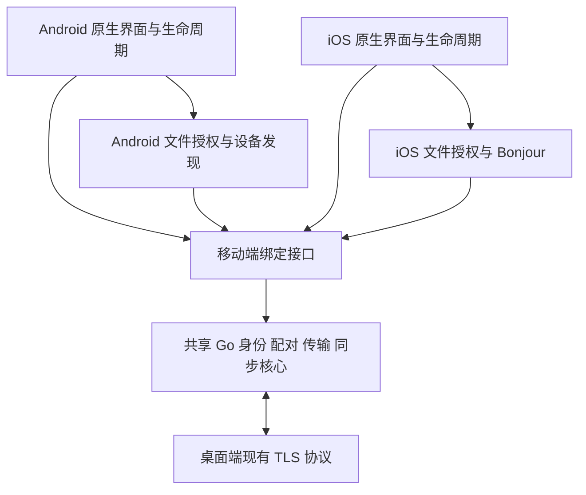

# PolySync 手机端与商店发布规划

调研日期：2026-09-21。基于当前仓库代码及 Apple、Google、工信部、小米官方资料。本文是实施建议，不代表手机端已经编译、运行或通过审核；平台要求在实际提交前再次核对。

已确认的需求：国内、海外都考虑；先跑通多端，再改进体验；目前没有可用于开发测试的 Mac 和 iPhone。Android 真机及开发者账号情况尚未确认。

## 1. 建议决策

先做 **Android 测试 APK + Windows 互通**，共享核心从第一天就考虑 iOS。获得 Mac 构建环境和 iPhone 真机后补齐 iOS，通过 TestFlight 测试，再分别上架 Google Play、国内安卓商店、中国区及海外 App Store。

产品分工建议：电脑承担低占用的长期在线节点；手机首先做到打开即可配对、收发文件、同步指定工作区，任务结束后减少活动。手机后台能力按系统分别定义，不承诺所有系统均能全天候实时接收。

第一版包括“随传”和“受控工作区的手动文件夹同步”两条闭环。系统任意授权文件夹的长期同步放到下一阶段；导入副本明确标为副本，不伪装成原文件夹的持续同步。

暂缓：蓝牙、互联网中继、账户云服务、全局相册自动备份、iOS File Provider 扩展、移动端完整三栏合并编辑器、桌面界面重做。加密、删除保护、中断后的状态正确性不作为体验优化延期。

## 2. 平台能力和真实边界

| 目标 | Android | iOS / iPadOS | 第一版承诺 |
| --- | --- | --- | --- |
| 与桌面局域网互传 | 原生网络与 Go 核心可作为实现路线 | 原生网络权限配合内嵌 Go 库 | 手机前台时双向收发 |
| 自动发现 | 优先原生 NSD 适配，保留手输地址 | 优先系统 Bonjour，声明服务类型 | 首先手动地址配对，再接发现 |
| 手机文件访问 | 系统选择器返回 URI，非普通磁盘路径 | 系统选择器、沙箱、安全作用域 URL | 导入、收件箱、系统导出 |
| 文件夹同步 | 先应用工作区，再 SAF 授权树 | 先应用工作区，再受授权目录/文件提供器 | 工作区手动双向同步 |
| 退到后台后传输 | 有通知的合规任务机制，存在时限及调度限制 | 用户发起的有限延续或系统后台传输机制 | 中断可解释、数据安全、可重试 |
| 永久后台等待接收 | 不作跨机型全天在线保证 | 不设计成常驻 TCP 服务 | 电脑持续在线，手机按需连接 |
| 应用更新 | 按分发渠道处理 | App Store / TestFlight | 不接入桌面 MSI 更新模块 |

### Android 后台

用户点击开始的大传输，优先评估 Android 14+ 的 User-Initiated Data Transfer Job；它带通知并受系统条件约束。可延迟的自动工作用系统调度机制。确有需要时再选择正确类型的前台服务，不能把一次任务和永久守候混为一谈。[Android UIDT 官方说明](https://developer.android.com/develop/background-work/background-tasks/uidt)

Android 15 对目标版本适用的 `dataSync` 前台服务施加后台累计运行限制：同类服务通常合计 24 小时内 6 小时，回到前台会重置计时，超时必须停止。它不是“显示常驻通知就能永远运行”的通行证。其他服务类型也不能仅为绕开限制而误用。[前台服务超时](https://developer.android.com/develop/background-work/services/fgs/timeout)

离线局域网也必须能用：调度和网络选择不能误把“必须能访问互联网”设为必要条件；Wi-Fi 有本地设备但没有外网时仍应能配对和传输。这是 PolySync 的验收设计，不是系统保证。

### iOS 后台

应区分三种需求：前台开始后继续完成一个任务、系统择机同步、无限等待外部连接。前两种有相应机制，第三种不能作为普通同步工具的产品承诺。系统决定 `BGProcessingTask` 等任务的执行时机；后台模式要符合实际用途。[Apple 后台策略](https://developer.apple.com/documentation/backgroundtasks/choosing-background-strategies-for-your-app)、[审核规则 2.5.4](https://developer.apple.com/app-store/review/guidelines/#software-requirements)

iOS 26 的 `BGContinuedProcessingTask` 值得在第二阶段做真机验证：由用户在前台发起，可在应用退到后台后继续有限任务，官方说明允许网络工作。需要进度、完成和过期/取消处理；不等于应用可以无限常驻或后台启动任意任务。[Apple 长任务说明](https://developer.apple.com/documentation/backgroundtasks/performing-long-running-tasks-on-ios-and-ipados)

如果后续希望采用系统托管的后台 `URLSession`，现有自定义 TCP 帧协议不能直接交过去：后台 session 支持 HTTP/HTTPS，上传还要求文件形式。需要另做兼容传输通道、认证及完成确认；不是换一个 API 名称即可。即使采用该机制，也不保证局域网对端一直可达。[Apple 后台下载限制](https://developer.apple.com/documentation/foundation/downloading-files-in-the-background)

## 3. 结合当前代码的技术路线

建议采用 **共享 Go 核心 + Kotlin Android 壳 + Swift iOS 壳**。`gomobile bind` 能产生 Android AAR 和 Apple XCFramework；这是可验证的工具路径，当前仓库还没有验证其完整绑定构建。固定 Go、x/mobile、NDK 和 Xcode 版本，先做构建探针。[gomobile 文档](https://pkg.go.dev/golang.org/x/mobile/cmd/gomobile)

| 方案 | 对当前项目的价值 | 代价 / 决策 |
| --- | --- | --- |
| Go 核心 + 原生轻量界面 | 复用协议和同步语义，直接接系统文件、后台、分享接口 | 两套少量界面；建议作为正式路线 |
| Go 核心 + 内嵌现有 Web UI | 调试阶段能复用已有状态与操作页 | 仍需原生权限、文件和生命周期适配；浏览器内存与 HTTP 接口需要额外处理 |
| Flutter 等跨平台 UI + Go | 更多界面代码可共享 | 增加桥接、构建和运行时组件；暂不作为首轮迁移内容 |
| 分别重写 Kotlin/Swift 同步核心 | 平台 API 使用直接 | 两套协议、冲突和安全逻辑长期易分叉；不建议 |

原生不等于已经证明更省内存；Go runtime 与平台界面都有成本，选择理由是系统集成和核心复用。先只做设备、发送/接收、工作区、状态四类基本操作，不等设计重做。

### 可复用和要隔离的代码

| 当前模块 / 事实 | 处理方式 |
| --- | --- |
| `internal/protocol`：TCP 帧与文件流 | 保留首轮协议及 TLS 身份；手机作为真实对等端 |
| `internal/syncer`：扫描、三方计划、冲突和替换 | 先复用应用私有工作区路径；外部文件提供器另做适配 |
| `internal/store`：配置、设备私钥、基线、历史 | 壳显式提供应用数据目录；研究平台密钥保护与备份排除，避免恢复备份后复制设备身份 |
| `internal/service`：配对、同步、随传、TCP 与定时任务 | 抽出移动可调用接口、状态回调、任务取消、可配置调度；后台活动受壳控制 |
| `Service.Start` 当前直接创建发现并启动 `autoLoop` | 注入发现与调度策略，移动前台恢复后可校对一次；不要默认带入永久 2 秒调度 tick |
| `internal/discovery/mdns.go`：第三方 zeroconf 直接多播 | 桌面保留；手机优先适配平台服务发现，不能假定直接多播在 iOS 获准 |
| `transfer_api.go` 等使用 Explorer、osascript、zenity | 拆到桌面适配；手机调用系统文件选择/导出，不启动外部命令 |
| `cmd/polysync`：信号、浏览器、托盘、更新 helper | 手机不运行此 main，也不把桌面 EXE 放入安装包 |
| 当前窗口关闭仍运行 | 手机由系统生命周期接管，区别于桌面 |

建议新增 `mobile/` 绑定层，平台工程放 `apps/android/`、`apps/ios/`。名称为规划示意，本文没有创建这些实现。

绑定接口先控制为 `Start`、`Stop`、配对、列设备、发送、任务取消、创建工作区、手动同步、订阅状态；必须设计成可重复进入/退出。现在 Service 取消后不能假定可直接复用同一实例，重新激活要创建干净实例并恢复持久状态。

Go/Java/Swift 边界只传小型元数据、事件、受控文件引用或流句柄。不要把几百 MB 的文件变成 `[]byte`、Base64 或 JSON 穿过桥接。第一版允许系统导入到工作区后传输，但应提示额外磁盘需求并清理自己的临时副本。

协议保持向后兼容；如果增加恢复、分块或新通道，要协商能力并保留旧路径。不得以手机端没有冲突编辑器为由静默选择某端覆盖：先展示冲突、保留双方并允许去电脑处理。

## 4. 两个最需要提前验证的适配点

### 文件与文件夹

Android SAF 通过系统选择器授权文件或目录，应用取得的是 `content://` URI。持久授权也可能失效，Android 11+ 还限制若干目录的选择。不能把 URI 拼成路径传给 `os.Open`，也不能将一次导入当作持续同步。默认用 SAF，不以全盘权限作为首版条件。[Android 文件访问](https://developer.android.com/training/data-storage/shared/documents-files)、[Google Play 全文件权限政策](https://support.google.com/googleplay/android-developer/answer/10467955?hl=en)

iOS 支持用户选目录并返回 security-scoped URL，可保存 bookmark 后再次访问，但需要维持有效授权并协调文件访问。第三方文件提供器、云端尚未下载的文件、用户撤销授权都需要处理；不能扫描其他应用私有目录。[Apple 目录授权](https://developer.apple.com/documentation/uikit/providing-access-to-directories)

首版把“PolySync 工作区”作为真正同步根；随传用系统选择器导入、从收件箱导出。下一阶段再做外部授权目录的双向同步适配，必须验证枚举、读取、创建、删除、重命名及原子替换能力。提供器暂时不可用时标记不可访问，**不能把空列表解释成全目录已删除**。禁止通过后台整目录复制来掩盖能力缺口。

### 设备发现与权限

iOS 需要局域网使用说明 `NSLocalNetworkUsageDescription`，声明 Bonjour 服务 `_polysync._tcp`。普通指定服务的 Bonjour 与直接 UDP 多播是不同路径：直接多播/广播涉及 multicast entitlement。建议先手动地址连通，再接系统 Bonjour；用户拒绝权限时给出可恢复状态。[Apple TN3179](https://developer.apple.com/documentation/technotes/tn3179-understanding-local-network-privacy)

Android 要按系统及 targetSdk 处理权限。当前官方文档规定目标 Android 17 / API 37+ 时有 `ACCESS_LOCAL_NETWORK` 运行时权限；目标 36 或以下不是同一处理方式。不要将桌面发现代码是否能编译当成手机发现已可用。[Android 局域网权限](https://developer.android.com/privacy-and-security/local-network-permission)

验收必须包括：无外网的 Wi-Fi、热点/AP 隔离、IPv4/IPv6、IPv6-only、权限拒绝后重新授权、切网、锁屏、回到前台。尤其当前发现实现跳过 IPv6 link-local 地址，纯本地 IPv6 场景需要检查接口作用域处理，不能只测家庭 IPv4 路由器。

## 5. Android 分发：国内与海外分别准备

### 测试 APK

最先产出能安装的签名 APK，不等全部商店材料完成。最小目标 Android 10 / API 29、arm64 可作为起点，是否扩大设备范围由真机测试决定，不是商店规定。首轮增加 x86_64 模拟器构建用于自动化，但模拟器不能替代真实 Wi-Fi 对等通信测试。

首个正式测试包之前确定应用包名、签名密钥保管和 versionCode 规则。不要用一次性 debug 签名当正式升级链；多个渠道应提前设计相同包名的签名兼容或独立包策略，避免用户只能卸载重装而丢失工作区。

### Google Play

| 项目 | 当前核实结果 | PolySync 准备 |
| --- | --- | --- |
| 开发者账号 | 注册费 25 美元一次，需身份验证 | 个人或组织按真实主体选择；不为规避测试填写虚假组织 |
| 新个人账号测试 | 2023-11-13 后创建的个人账号需至少 12 名测试者连续参加封闭测试 14 天，再申请生产权限 | 提前准备真实测试者、场景和反馈，不能把 14 天当作自动过审 |
| 包格式 | 新应用使用 AAB 发布 | 同源产出测试 APK 和商店 AAB |
| 目标 SDK | 2026-08-31 起新应用/更新要求 Android 16 / API 36+ | 首轮按至少 API 36 开发，另测试 API 37 的行为 |

来源：[账号注册](https://support.google.com/googleplay/android-developer/answer/6112435?hl=en)、[封闭测试要求](https://support.google.com/googleplay/android-developer/answer/14151465?hl=en)、[AAB](https://developer.android.com/guide/app-bundle)、[目标 API 政策](https://support.google.com/googleplay/android-developer/answer/11926878?hl=en)。

Go 编译进来的共享库也属于 native code。16 KiB 页大小必须纳入构建与安装验收，不能只检查 Kotlin 工程；核对最终 AAB/APK 中所有 `.so` 的对齐和运行行为。官方页当前列出兼容要求及后续执行时间，提交时复核，项目不把延期当作不适配的理由。[16 KiB 页支持](https://developer.android.com/guide/practices/page-sizes)

填写 Data safety、隐私政策、权限/后台用途、内容分级、审核访问说明和商店图文。局域网文件直传不等于可以未经核对直接选“不收集任何数据”：文件、设备名、诊断日志及第三方组件分别按平台定义判断。Google 对仅设备内处理、符合其定义的端到端加密数据有例外，应核实实际实现。[Data safety](https://support.google.com/googleplay/android-developer/answer/10787469?hl=en)

Play 渠道更新走 Play 的更新机制，不能下载安装新的 Go `.so` 或自行替换 APK。国内 APK 渠道若后续做应用内更新，单独设计渠道能力；手机首版先跳转相应分发入口。[Google 更新政策](https://support.google.com/googleplay/android-developer/answer/16559646?hl=en-GB)

Google 的 Android 开发者验证也在向非 Play 渠道扩展：当前官方计划 2026-09-30 起针对巴西、印尼、新加坡、泰国的参与商店及认证设备执行，2027 年继续扩大。不要把它表述为“现在全球侧载都必须上 Play”；海外分发时核对地区和渠道要求。[Android developer verification](https://developer.android.com/developer-verification)

### 国内安卓商店

建议首批只接一家能覆盖实际测试机的商店，例如小米，再逐个扩展 OPPO、vivo、应用宝等。各家的开发者主体、类目、材料和审核不同，没有一份 APK 上传一次就覆盖国内所有商店的流程。当前核实了小米公开流程，其他渠道详细材料需在确定首批渠道后逐项复核，不能据此保证均接受个人开发者。

小米流程明确要求 APK、应用资料、隐私政策网址、联系人、截图及资质，并要求名称与其认可的软著材料对应。规划中预留软件著作权/权属证明准备；它和 APP 备案是两件事，也不能把一家要求写成所有平台统一要求。[小米应用创建与发布](https://dev.mi.com/xiaomihyperos/documentation/detail?pId=1072)

工信部通知针对在境内从事互联网信息服务的 APP 主办者规定备案义务。PolySync 目前以局域网为核心，对其实际功能、联网行为和拟分发渠道的适用性，应在国内首发前向备案接入方/主管部门及商店确认；不要自行断言“没云服务器所以一定不用备案”，也不要把所有纯本地工具一概认定必须办理。若适用，提前准备主体、包名、签名等资料。[工信部 APP 备案通知](https://www.gov.cn/zhengce/zhengceku/202308/content_6897341.htm)

核心不依赖 Google Play 服务，保证国内无 GMS 的 Android 环境能配对、收发、同步；推送、统计和商业 SDK 均不作为第一版依赖。目标设备若不是 Android 运行环境，应单独做平台评估，不能因为同一厂商就视为 APK 可安装。

## 6. iOS / App Store 发布

### 环境与费用

Apple Developer Program 标准费用为每年 99 美元，实际本地币种价格以注册页面为准。组织账号通常要核验法律实体及 D-U-N-S；个人账号可作为真实个人身份发布，但需考虑公开展示身份及后续主体迁移。[Apple 注册要求](https://developer.apple.com/programs/enroll/)

构建需可运行相应 Xcode 的 Mac 环境；目前没有 Mac 和 iPhone，因此 iOS 真机阶段是外部依赖。可以先借用设备或取得远程 Mac 构建环境，不必在 Android 验证前购买新设备。远程 CI 能解决编译和签名，不能独自验证与本地电脑同一 Wi-Fi 的真实使用场景。

Apple 当前要求自 2026-04-28 起上传构建使用 Xcode 26+ 和 iOS 26 SDK+。构建 SDK 不等于最低支持系统；最低 iOS 版本建议在绑定探针后决定，若支持旧系统，新后台 API 必须有降级行为。[Apple 提交要求](https://developer.apple.com/news/upcoming-requirements/)

### 先 TestFlight，再商店

开发设备安装 → 内部测试 → TestFlight 外部测试 → 正式 App Store。TestFlight 构建有效期最长 90 天，外部测试首个构建需要相应审核；不是永久免费分发渠道。[TestFlight 官方说明](https://developer.apple.com/help/app-store-connect/test-a-beta-version/testflight-overview/)

商店审核重点为：功能确实可用、文件选择/导出符合系统交互、后台用途真实、描述不夸大、更新不下载执行新的功能代码。内嵌 Web UI 并非自动不合规，但只套一个网页壳有最低功能风险；无必要为调研阶段先重做全部原生界面。[Apple 审核规则 2.5、4.2](https://developer.apple.com/app-store/review/guidelines/)

为依赖另一台设备的功能提供详细审核说明：可下载的桌面配套版本、两端配对步骤、同局域网条件、样例文件、录屏和联系渠道。应用自身的收件箱、文件导入导出、任务状态要可操作。示例数据必须显式标识，不能用假“连接成功”掩盖真实不可用；若审核方要求额外资源再按要求提供。

准备 Bundle ID、签名与权限配置、截图、支持网址、隐私政策、隐私标签、年龄分级。检查 Go/runtime/依赖是否触及文件时间戳、磁盘空间等 required-reason API，并在 `PrivacyInfo.xcprivacy` 按真实用途声明；不能仅因“核心不是 Swift”就忽略。[隐私标签](https://developer.apple.com/app-store/app-privacy-details/)、[Required Reason API 清单](https://developer.apple.com/documentation/technotes/tn3183-adding-required-reason-api-entries-to-your-privacy-manifest)

现有 TLS 1.3、Ed25519 与 Go 自带密码实现需要如实回答出口合规问卷；不能未经判断直接设置“无加密/豁免”标志。是否需要文档由加密用途、分发地区和问卷结果决定。[Apple 出口合规](https://developer.apple.com/help/app-store-connect/manage-app-information/overview-of-export-compliance)

中国区 App Store 还要核对适用的 ICP/APP 备案及元数据一致性；海外可用并不自动等于中国区可用。与国内 Android 资料准备同步推进，不把地区选择留到上传前一天。[Apple 中国大陆可用性说明](https://developer.apple.com/help/app-store-connect/reference/app-information/app-information)

## 7. 分阶段实施与验收

以下为一个主要开发者、已有桌面代码可用前提下的粗估工作日；尚未做手机构建探针，误差可能较大。不含设备取得、账号验证、备案、测试者招募、封闭测试的日历等待及审核往返。

| 阶段 | 粗估 | 工作与产出 | 通过条件 |
| --- | --- | --- | --- |
| M0：绑定与生命周期探针 | 2–4 日 | Android AAR、最小宿主；Go 核心 start/stop；列出平台依赖 | 同一进程启动/停止 20 次，无重复监听、失控 goroutine 或配置损坏；桌面测试保持通过 |
| M1：Android ↔ Windows 最小闭环 | 5–8 日 | 签名 APK；手动配对、双向随传、收件箱导出、应用工作区手动同步；通知和中断反馈 | 真机双向文件哈希一致；增改删/冲突符合桌面语义；断网/取消不标假成功、不误删 |
| M2：iOS 与跨手机互通 | 5–8 日，环境到位后 | XCFramework、原生壳、权限和文件选择；开发安装包/TestFlight | iPhone ↔ Windows、Android ↔ iPhone 真机互传；挂起恢复、重启身份、权限拒绝可恢复 |
| M3：移动文件夹和后台适配 | 5–10 日 | Android SAF 目录；iOS 授权目录验证；按系统选择任务延续；系统分享入口 | 撤权/提供器失联不传播删除；后台超时正确落盘；新旧桌面版本兼容 |
| M4：商店首发 | 3–5 日工程准备，另计审核等待 | AAB、渠道 APK、iOS archive；中英文图文、隐私、资质与审核说明 | 真机矩阵通过、正确签名升级、生产权限及渠道材料齐全 |

**下一次开发只进入 M0–M1，不同时铺开所有商店接入。** M0 后按真实构建结果重新估期；Mac/iPhone 未到位不阻塞 Android，但 M2 没有真机证据前不承诺 iOS 可用。账号/国内材料可与技术实现同时准备。

首个 Android 包建议功能清单：

1. 显示设备名和连接地址，手动地址配对；平台发现可稍后接入。
2. 系统选择文件发送，已配对设备接收，进度/取消/失败重试。
3. 收件箱打开或导出，明确暂存位置和清理。
4. 创建 PolySync 工作区，接受桌面文件夹邀请，点按同步一次；显示冲突并保留两端内容。
5. 页面/应用状态变化时有明确“正在传输、已暂停、需重新连接”反馈。
6. 不需要注册账号，不依赖外网服务，首次只请求正在使用的权限。

### 测试矩阵

- 连接：Windows ↔ Android、Windows ↔ iOS、Android ↔ iOS；保留 Linux/macOS 核心构建回归，后续补各自真机证据。
- 数据：空文件、中文/emoji 文件名、同名文件、小文件批量、1 GiB 测试文件、低磁盘空间、修改/删除冲突。1 GiB 是测试样本，不是尚未测量的性能承诺。
- 生命周期：锁屏、切后台、系统回收、用户强停、切 Wi-Fi、无外网、取消后重开、升级后设备身份保留。首版可失败后重传，不冒充已支持断点续传。
- 文件授权：拒绝、撤销、授权目录移动/删除、提供器暂离线、云文件未下载、路径恶意输入；不可访问与文件被删除分开处理。
- 安全：公钥不匹配、未配对请求、越界路径、传输校验失败、移动桥接入口仅接受预期调用。
- 兼容：Android 至少一台接近原生和一台国内厂商真机，4 KiB/16 KiB 页环境；iPhone 测最低支持系统与当前系统条件下的能力差异。

### 轻量化的验收方式

本轮不预设未经测量的“手机后台仅占 X MB”。分别测 Android 进程总 PSS/原生堆/Java 堆、iOS 内存 footprint、Go 堆和 goroutine 数；若用 WebView，单独记录相关进程成本。不能拿桌面工作集与手机 PSS 直接相等比较。

测试前台空闲、后台无任务、传输中、结束后回落，以及 30 分钟无操作耗电/CPU 唤醒。移动后台无任务时不维持应用级快速轮询或常开全目录扫描。Android 已完成工作及时停止任务；iOS 服从挂起。具体阈值在 M1 真机基线上确定，不为压低数字频繁强制 GC。

## 8. 当前可以开始和仍需准备的事项

可以立即开始：M0 的 Go 绑定接口、Android 构建工具链核对、平台功能开关、临时测试目录和桌面互通夹具。不要先改写现有同步协议，也不顺带发布尚未发布的桌面版本。

开发前需确认的资源：Android 测试机；iOS 阶段可访问的 Mac 与 iPhone；最终开发者主体、包名/Bundle ID、签名密钥保管；首批国内商店。开发者会员费之外，Mac 构建环境、设备、资质、域名/隐私政策托管的成本按实际选择报价，本文不虚构预算。

本次仅新增规划文档及 README 入口，没有修改运行代码、安装 SDK、购买账号、创建手机安装包或提交商店审核。因此不新增代码测试，也不声称完成手机实测。
